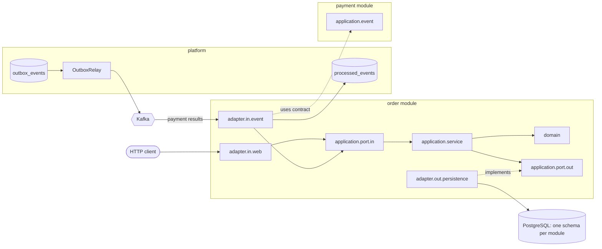

# OrderFlow

An order and payment backend in Java 21 and Spring Boot, used as a testbed for one question:
**does an engineering harness make an AI coding agent (Claude Code) produce changes that respect the architecture,
pass the tests and need less review than minimal project instructions?**

| | |
|---|---|
| **What exists** | A modular monolith with Hexagonal Architecture: order placement and lookup over REST, an idempotent Kafka consumer that applies payment results to orders, a tested transactional-outbox relay, metrics, structured logging and dashboards. An engineering harness for Claude Code: project instructions, skills, a written development workflow, ArchUnit rules and a quality gate enforced in CI. A benchmark design with 10 tasks, hidden acceptance tests and reference solutions. |
| **What is measured** | Every quality-gate figure below comes from a run of `scripts/quality-gate.sh` (date given). Every hidden acceptance test was shown to fail on the starting code and pass with a reference solution. |
| **What is not measured yet** | **The benchmark has not been run.** There are no results comparing the harness with minimal instructions, and this README makes no claim that the harness improves anything. |

**Contents:** [Problem](#problem-statement) · [System architecture](#system-architecture) ·
[Harness](#harness-architecture) · [Technology](#technology-choices) · [Local setup](#local-setup) ·
[Quality gates](#quality-gates) · [Evaluation](#evaluation-methodology) · [Results](#benchmark-results) ·
[Limitations](#limitations-and-trade-offs)

## Problem statement

AI coding agents write code that compiles and passes its own tests, but they also take shortcuts a senior reviewer
would reject: business logic in controllers, one module reading another's tables, an edited migration, a test
weakened until it passes. Prompting "follow the architecture" does not make the architecture checkable.

OrderFlow treats this as an engineering problem:

1. **Make the rules explicit and executable**: architecture rules as ArchUnit tests, conventions in `CLAUDE.md`,
   a fixed workflow (propose → approve → implement → gate → evidence).
2. **Enforce them where the agent cannot skip them**: one quality-gate script, run locally and as a required CI check.
3. **Measure the effect** instead of assuming it: a controlled benchmark of the harness against minimal
   instructions, on the same code, model and tasks.

The domain (orders and payments) was chosen because it has the failure modes that matter in production:
state machines, money, duplicate messages, partial failures and module boundaries.

## System architecture

A **modular monolith** with **Hexagonal Architecture** inside each module
([ADR-0001](docs/adr/0001-modular-monolith-with-hexagonal-architecture.md),
[architecture.md](docs/architecture/architecture.md)).



- **Modules:** `order` (implemented), `payment` (only its event contracts so far), a small `shared` kernel (`Money`)
  and `platform` (outbox, inbox, correlation IDs). Each module owns its own database schema; no cross-module foreign
  keys or joins.
- **Layers:** `adapter → application → domain`. The domain is plain Java (no Spring, JPA or Jackson). Other modules
  are reached only through `application.port.in` and `application.event`.
- **Order lifecycle** ([ADR-0002](docs/adr/0002-event-driven-payment-workflow.md)): the `Order` aggregate implements
  `CREATED → PAYMENT_PENDING → PAID | PAYMENT_FAILED`, with a retry through a new payment attempt; invalid transitions
  raise a domain exception. Requesting a payment has no use case or endpoint yet (it is benchmark task T04).
- **Messaging** ([ADR-0003](docs/adr/0003-transactional-outbox-and-kafka.md)):
  - **Consuming (in use):** the order module consumes `PaymentSucceeded`/`PaymentFailed` from Kafka. Delivery is
    at-least-once, so it deduplicates on the event ID (`processed_events`) in the same transaction as the state
    change. Records that still fail after 3 attempts are moved to `<topic>.DLT`.
  - **Publishing (infrastructure only):** an `OutboxWriter` that requires the caller's transaction and a relay that
    publishes to Kafka with `acks=all` and an idempotent producer exist and are integration-tested, but no business
    code publishes an event through them yet.
- **Observability** ([observability.md](docs/operations/observability.md), [runbook](docs/operations/runbook.md)):
  business metrics counted only after commit, messaging metrics for failures, duplicates and the outbox, bounded
  metric tags (enforced by a test), a correlation ID carried from the HTTP request through the outbox and Kafka
  headers to the consumer logs, JSON logs in `prod`, and a test that fails if card data appears in any log line.
  Prometheus, a Grafana dashboard and alert rules run locally with `docker compose`.

## Harness architecture

The harness is everything that steers or checks the agent. It has two layers: **guidance** the agent reads and
**guardrails** that fail the build whether or not the agent read anything.

```mermaid
flowchart TB
    subgraph guidance [Guidance: read by the agent]
        claude[CLAUDE.md: rules, conventions, commands, Definition of Done]
        workflow[AI development workflow: propose, approve, implement, gate, evidence]
        skills[Skills: api-design, architecture-review, unit-testing, orderflow-code-review]
        docs[ADRs, architecture.md, testing strategy]
    end
    subgraph guardrails [Guardrails: executed]
        arch[ArchUnit: 11 rules + schema-ownership test]
        tests[Unit tests, Testcontainers integration tests]
        style[Checkstyle, JaCoCo thresholds]
        gate[scripts/quality-gate.sh]
        ci[GitHub Actions: required check on main]
    end
    claude --> gate
    arch & tests & style --> gate --> ci
```

| Component | Where | What it does |
|---|---|---|
| Project instructions | [`CLAUDE.md`](CLAUDE.md) | Architecture essentials, coding conventions, verification commands, Definition of Done, 14 rules for changing code (e.g. never edit an applied migration, never disable a failing test or architecture rule) |
| Workflow | [`ai-development-workflow.md`](docs/process/ai-development-workflow.md) | Understand → propose → approve → implement one increment → run the gate → inspect → fix → re-run → summarize evidence; failure triage and escalation rules |
| Skills | [`.claude/skills/`](.claude/skills) | Task-specific checklists the agent loads on demand: API design, architecture review (including what ArchUnit cannot check), unit testing, code review |
| Architecture tests | [`ArchitectureTest`](src/test/java/com/orderflow/architecture/ArchitectureTest.java), `SchemaOwnershipIT` | Layering, pure domain, ports-only access, module APIs, no module cycles, no cross-schema foreign keys |
| Quality gate | [`scripts/quality-gate.sh`](scripts/quality-gate.sh) | compile → Checkstyle → unit → ArchUnit → integration → coverage; stops at the first failure |
| CI | [`.github/workflows/ci.yml`](.github/workflows/ci.yml) | Runs the same script; branch protection makes it a required check on `main`, also for admins |

**Evidence that the guardrails work:**

- [ArchUnit violation demo](docs/architecture/archunit-violation-demo.md): a deliberate violation fails the rule;
  the violation is then removed.
- [Week 3](docs/process/evidence/week3-create-order/README.md): a feature built through the workflow, with a fault
  injected to show the gate fails, then reverted (raw logs included).
- [Week 4](docs/process/evidence/week4-ci-pr/README.md): a pull request that fails CI on a rule violation and turns
  green after the fix (CI logs and branch-protection settings included).

## Technology choices

| Choice | Why |
|---|---|
| Java 21, Spring Boot 4.1, Maven wrapper | Java LTS release; records for value objects; reproducible builds without a global Maven |
| Modular monolith instead of microservices | Clear module boundaries with one deployable and no network between modules while the domain is still being discovered; modules can be extracted later ([ADR-0001](docs/adr/0001-modular-monolith-with-hexagonal-architecture.md)) |
| PostgreSQL 17 + Flyway, Hibernate `validate` | Schema changes only through reviewed, versioned migrations; one schema per module |
| Kafka 4.2 + transactional outbox | A state change and its event are atomic without distributed transactions; at-least-once delivery with consumer-side deduplication ([ADR-0003](docs/adr/0003-transactional-outbox-and-kafka.md)) |
| Testcontainers (never H2) | Integration tests run against the real PostgreSQL and Kafka versions |
| ArchUnit | Architecture rules become failing tests, which an agent cannot skip by ignoring the instructions |
| Checkstyle, JaCoCo | Cheap, deterministic checks; coverage thresholds catch untested areas, not test quality ([quality-tools.md](docs/quality/quality-tools.md)) |
| Micrometer + Prometheus, Grafana | Standard Spring Boot metrics stack; histograms aggregate across instances |
| No Lombok, no MapStruct, no generators | Less magic for reviewers and the agent; no generated code to exclude from coverage |

## Local setup

**Prerequisites:** JDK 21 (`export JAVA_HOME=$(/usr/libexec/java_home -v 21)` on macOS) and Docker
(tests start PostgreSQL and Kafka via Testcontainers).

```bash
docker compose up -d          # PostgreSQL on localhost:5432, Kafka on localhost:9092
                              # add --profile observability for Prometheus (:9090) and Grafana (:3000)
./mvnw spring-boot:run        # uses the "local" profile by default
curl localhost:8080/actuator/health
```

| Profile | Purpose | Database and Kafka |
|---|---|---|
| `local` (default) | Developer machine | `compose.yaml` PostgreSQL and Kafka |
| `prod` | Deployed environments | `DB_URL`, `DB_USERNAME`, `DB_PASSWORD`, `KAFKA_BOOTSTRAP_SERVERS` env vars (required); Actuator on port `MANAGEMENT_PORT` (default 8081) |

Tests run with the default `local` profile, but Testcontainers replaces the database and Kafka connections via
`@ServiceConnection`. Test-only overrides (outbox relay disabled, short Kafka timeouts) live in
`src/test/resources/config/application.yml`.

**API**

| Method | Path | Result |
|---|---|---|
| `POST` | `/api/v1/orders` | `201` + `Location`; `400` `application/problem+json` on invalid input |
| `GET` | `/api/v1/orders/{id}` | `200` with the order; `404` problem if unknown; `400` if the ID is not a UUID |

```bash
curl -i -X POST localhost:8080/api/v1/orders -H 'Content-Type: application/json' \
  -d '{"customerId":"c-1","currency":"EUR","lines":[{"productId":"p-1","quantity":2,"unitPrice":19.99}]}'
```

**Health and metrics:** `/actuator/health` (details only in `local`), `/actuator/health/{liveness,readiness}`,
`/actuator/prometheus`, `/actuator/metrics`. In `prod` these are served on the management port (8081), not the API
port. Consumed events that keep failing are moved to `<topic>.DLT` after 3 attempts.

## Quality gates

```bash
scripts/quality-gate.sh   # compile → Checkstyle → unit → ArchUnit → integration → JaCoCo coverage; non-zero exit on first failure
./mvnw clean verify       # same checks in one Maven run
```

CI runs the same script on pull requests to `main` and pushes to `main`, writes a per-stage table to the run
summary and attaches all reports as the `quality-reports` artifact.
Test naming decides where a test runs: `*Test` without Spring or Docker (Surefire), `*IT` with a Spring context or
Docker (Failsafe). Coverage report: `target/site/jacoco/index.html`.

Last run: 2026-10-31 on `feature/harness-benchmark`, macOS, JDK 21, Docker (re-run the command to reproduce):

| Stage | Result |
|---|---|
| Compile | OK |
| Checkstyle | 0 violations |
| Unit tests (`*Test`, no Spring, no Docker) | 57 run, 0 failed |
| Architecture (`ArchitectureTest`) | 11 rules, 0 failed |
| Integration tests (`*IT`, Testcontainers PostgreSQL and Kafka) | 39 run, 0 failed |
| Coverage (JaCoCo, unit + integration) | lines 97.7 % (519 of 531), branches 88.0 % (110 of 125); all thresholds met |

Coverage thresholds: ≥ 85 % lines and ≥ 75 % branches overall, ≥ 95 % lines and ≥ 85 % branches per domain package
([quality-tools.md](docs/quality/quality-tools.md)). Coverage shows that code ran, not that it was asserted; test
quality is judged in review, and the tests were checked by fault injection
([testing-strategy.md](docs/testing/testing-strategy.md)).

## Evaluation methodology

Full protocol: [benchmark-design.md](docs/benchmark/benchmark-design.md) · task files and hidden tests:
[`benchmark/`](benchmark/README.md) · report format: [report-template.md](docs/benchmark/report-template.md).

- **Two arms, same code.** Both start from the same commit. **A, minimal instructions:** a 5-line `CLAUDE.md`, no
  skills, no process docs, no architecture tests, no Checkstyle/JaCoCo, no gate script. **B, full harness:** as in
  this repository.
- **10 tasks** in six categories: REST API (T01, T02), business rules (T03, T04), database (T05, T06),
  cross-module (T07, T08), refactoring (T09), error handling (T10). Each prompt states the requirement as an
  external contract and is identical in both arms. Each task has documented architecture traps: the easy solution
  breaks a rule.
- **Same conditions.** One pinned model and Claude Code version, the same permissions and limits, offline Maven,
  3 repetitions per task and arm (60 runs) in a seeded random order on one machine.
- **Isolation.** Every run starts from a fresh, history-free clone and an empty Claude Code configuration, so no
  context, memory or earlier run can leak in. The agent never sees the hidden tests, the task specifications or the
  other arm.
- **Fixed conversation, no human in the loop:** the prompt, then "Approved. Proceed with the implementation and
  verify it.", then up to 3 automated correction rounds that list the failing hidden tests by name and first line of
  the failure message; the test code itself is never shown.
- **Hidden oracle.** After each round a copy of the agent's work gets the hidden tests: the task's acceptance
  tests, a copy of the architecture rules, a schema-ownership test and a check that existing migrations are
  unchanged. The existing tests act as the regression suite.
- **Metrics** (defined before any run): architecture violations, test pass rate, human review effort (minutes and
  findings in a blinded review of the code diff), correction iterations; secondary: false success claims, weakened
  tests, edited migrations, scope creep, cost.
- **Analysis:** per-task results next to the aggregate; paired Wilcoxon signed-rank test over the 10 tasks, with
  hypotheses stated in advance.
- **Reporting:** [`report.py`](benchmark/scripts/report.py) builds the report from the recorded run files only.
  Missing values are shown as "not recorded", never as zero; invalid records are listed with the reason; the
  interpretation is written by a person in a separate file and must cite the measured facts it relies on.

## Benchmark results

**The benchmark has not been run.** No agent run has been executed in either arm, so there are no results for
architecture violations, pass rate, review effort or correction iterations, and no evidence yet that the harness is
better or worse than minimal instructions.

What has been measured is that the **hidden tests are valid**
([validation reports](benchmark/oracle/validation), recorded 2026-10-30). For each task, on a fresh clone:

| Task | Hidden task tests | Failing on the starting code | Passing with the reference solution (all tests incl. regression and architecture) |
|---|---|---|---|
| T01 List orders | 6 | 6 of 6 | 133 of 133 |
| T02 Cancel order | 6 | 6 of 6 | 144 of 144 |
| T03 Order limits | 6 | 3 of 3 acceptance (3 guard tests pass, as required) | 132 of 132 |
| T04 Payment attempts | 7 | 7 of 7 | 139 of 139 |
| T05 Shipping address | 4 | 4 of 4 | 121 of 121 |
| T06 Status history | 5 | 5 of 5 | 132 of 132 |
| T07 Payment fee | 6 | 6 of 6 | 136 of 136 |
| T08 OrderPlaced event | 6 | 4 of 4 acceptance (2 guard tests pass) | 130 of 130 |
| T09 CustomerId refactoring | 7 | 3 of 3 acceptance (4 guard tests pass) | 132 of 132 |
| T10 Error responses | 6 | 6 of 6 | 129 of 129 |

Guard tests protect behaviour that must not change, so they must pass on the starting code. Each reference solution
also passed the project's own quality gate. This shows the oracle can tell a correct solution from the unchanged
code; it says nothing about how either arm performs.

Results will be added here only from the generated report, once runs exist.

## Limitations and trade-offs

**System**

- **The payment side is a contract only.** The payment module defines `PaymentSucceeded` and `PaymentFailed`;
  nothing in the repository processes payments or produces those events yet, and there is no payment provider.
  The order module cannot request a payment through the API, and no business code publishes events through the
  outbox yet. The end-to-end payment flow of ADR-0002 is therefore designed but not built.
- **No authentication or authorization.** The Actuator management port in `prod` must be reachable only inside the
  network.
- **Open design conflict:** rule 9 (no module cycles) forbids the `payment → order` dependency that ADR-0002's flow
  implies, because `order` already depends on payment events. This needs an ADR before the payment module is built
  ([open points](docs/architecture/architecture.md#known-open-points)).
- **At-least-once delivery** costs a deduplication table and consumers that must be idempotent; a stuck outbox event
  blocks the ones behind it by design (per-key order). There is no outbox cleanup and no tool to replay DLT records.
- **Monitoring is local only:** alert rules and dashboards exist, but no monitoring stack is deployed.
- **Module boundaries in one database** are enforced by ArchUnit and a schema-ownership test, not by separate
  databases; cross-schema SQL in strings is found only in review.

**Harness and benchmark**

- **Not yet evidence of benefit.** The harness has been used to build this project, but whether it beats minimal
  instructions is the open question the benchmark is designed to answer.
- **No runner yet.** The script that clones, runs the agent, evaluates and collects the records is not written.
- **Author bias:** the same person wrote the harness, the tasks, the traps and the hidden tests. Mitigations:
  traps documented up front, hidden tests that use only the external contract, per-task reporting; an independent
  review of the tasks is recommended.
- **Public hidden tests:** the repository is public, so the task specifications, hidden tests and reference
  solutions are visible. Runs are isolated from them, but future models may have seen them.
- **Small sample:** 10 tasks × 3 repetitions gives limited statistical power; effect sizes and intervals will be
  reported, not only p-values.
- **Single model and project:** results will hold for one model version on one Java/Spring codebase.
- **Cost of the harness:** more instructions, a longer approval loop and a slower gate (Testcontainers) per change.
  The benchmark records tokens and wall-clock time to make this trade-off visible.
- **Coverage thresholds** are deliberately below the measured baseline and measure execution, not assertion quality.

## Repository map

| Path | Content |
|---|---|
| `src/main/java/com/orderflow/` | `order`, `payment`, `shared`, `platform` |
| `src/main/resources/db/migration/` | Flyway migrations `V1`–`V5` |
| `docs/adr/` | Architecture decision records |
| `docs/architecture/`, `docs/testing/`, `docs/quality/` | Rules, test strategy, quality tools |
| `docs/process/` | AI development workflow and evidence logs |
| `docs/operations/` | Observability and runbook |
| `docs/benchmark/`, `benchmark/` | Benchmark design, tasks, hidden tests, reference solutions, scripts |
| `ops/` | Prometheus and Grafana configuration |
