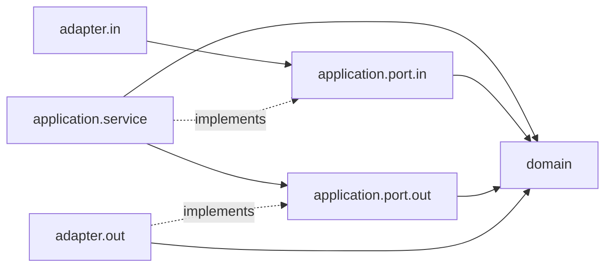
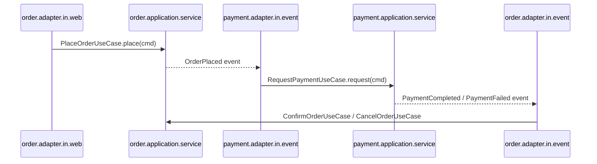

# OrderFlow Architecture

OrderFlow is a **modular monolith**: one deployable Spring Boot application, split into business modules with
enforced boundaries. Inside each module we apply **Hexagonal Architecture** (ports and adapters).
Rationale: [ADR-0001](../adr/0001-modular-monolith-with-hexagonal-architecture.md).

## Modules

| Module | Responsibility |
|---|---|
| `order` | Order lifecycle: placing, confirming, cancelling orders |
| `payment` | Payment lifecycle: requesting, completing, failing payments |
| `shared` | Shared kernel: small, stable, generic value types only (e.g. `Money`) |
| `platform.observability` | Technical module: correlation ID (HTTP filter, logging context) used by `platform.messaging` |
| `platform.messaging` | Technical module: transactional outbox, Kafka relay, consumer deduplication ([ADR-0003](../adr/0003-transactional-outbox-and-kafka.md)). Public API: `platform.messaging.api` |

## Package structure

```
com.orderflow
├── OrderFlowApplication
├── shared
│   └── domain                     generic value objects (Money, ...)
├── order
│   ├── domain                     aggregates, value objects, domain events, domain exceptions
│   ├── application
│   │   ├── port.in                use case interfaces + command/result records   (public API)
│   │   ├── port.out               interfaces the module needs: repositories, gateways, event publisher
│   │   ├── event                  integration events published to other modules  (public API)
│   │   └── service                use case implementations
│   └── adapter
│       ├── in.web                 REST controllers, request/response DTOs
│       ├── in.event               listeners for other modules' integration events
│       ├── out.persistence        JPA entities, Spring Data repositories, mappers
│       ├── out.metrics            Micrometer implementation of the module's metrics port
│       └── out.event              event publisher implementation
├── payment                        same layout as order
└── platform
    ├── messaging
    │   ├── api                    OutboxWriter, ProcessedEvents: the only types business modules may use (public API)
    │   ├── outbox                 JDBC outbox writer, Kafka relay, scheduling, metrics (internal)
    │   └── inbox                  consumer deduplication store, listener retry + dead-letter handling,
    │                              logging context of consumed records (internal)
    └── observability              correlation ID: HTTP filter, logging-context key
```

Sub-packages are created when the first class needs them; empty layers are not scaffolded.

## Layer responsibilities

| Layer | Contains | May depend on |
|---|---|---|
| `domain` | Business rules and invariants. Plain Java. | JDK, `shared.domain` |
| `application.port.in` | What the module *offers*: use case interfaces, commands, results | own `domain`, `shared.domain` |
| `application.port.out` | What the module *needs*: interfaces implemented by adapters | own `domain`, `shared.domain` |
| `application.event` | Immutable records describing facts other modules may react to | `shared.domain` only |
| `application.service` | Use case orchestration and transaction boundaries | own `domain`, own `application.*` |
| `adapter.in.*` | Translate external input (HTTP, events) into use case calls | own `application.port.in`, other modules' public API |
| `adapter.out.*` | Implement `port.out` using technology (JPA, Spring events, Kafka) | own `application.port.out`, own `domain` |

## Dependency rules

### Inside a module: dependencies point inward



1. `domain` depends on nothing but the JDK and `shared.domain`. **No Spring, JPA, Jackson or validation annotations.**
2. `application` never depends on `adapter`.
3. Only `@Service` and `@Transactional` from Spring are allowed in `application.service`. No other framework types in `application`.
4. Inbound adapters call the application only through `port.in` interfaces, never `service` classes,
   `port.out`, outbound adapters or Spring Data repositories ([demo](archunit-violation-demo.md)).
5. Adapters do not depend on each other (`in.web` must not use `out.persistence`, etc.).
6. Persistence uses **separate JPA entities** in `adapter.out.persistence`, mapped to and from domain objects.
   Domain objects are never annotated with `@Entity`.

### Between modules: only through the public API

A module's **public API** is exactly two packages:

- `<module>.application.port.in`: synchronous use case calls
- `<module>.application.event`: integration events

Rules:

7. A module may depend on another module **only** through its public API.
   Another module's `domain`, `application.service`, `application.port.out` and `adapter` packages are off-limits.
   Business modules may use `platform.messaging.api`, and only from their `adapter` packages (behind their own ports).
8. Cross-module dependencies originate in `adapter.in` (e.g. an event listener in `payment` that reacts to
   `order` events), never in `domain`.
9. No dependency cycles between modules.
10. `shared` depends on no business module. It holds only generic, behaviour-light value types; business rules stay in modules.
11. Each module owns its data: one PostgreSQL schema per module, no cross-module foreign keys, joins or table access.
12. Technical `platform` modules depend on no business module (only on `shared` and libraries).

Rules 1–10 and 12 are enforced by ArchUnit (`src/test/java/com/orderflow/architecture/ArchitectureTest.java`, one test per rule);
rule 11 partly by `SchemaOwnershipIT` (no cross-schema foreign keys, checked against the real schema);
cross-schema joins and native SQL remain a code review concern.

## Communication between modules

- **State changes → integration events** (preferred). Published through a `port.out` publisher whose `out.event`
  adapter writes to the transactional outbox in the same DB transaction; the relay publishes to Kafka at least once,
  and consumers deduplicate on `eventId` ([ADR-0003](../adr/0003-transactional-outbox-and-kafka.md)).
- **Queries / commands that need an immediate answer → `port.in` calls.** Used sparingly, since it couples modules in time.

Integration events are separate from internal domain events: they are a stable contract
(records with IDs and primitive/`shared` types), so a module's internal model can change without breaking consumers.

### Example: placing an order



## Known open points

- **Reliable event delivery:** resolved by the transactional outbox (ADR-0003).
  Remaining: outbox cleanup and retention, a way to inspect and replay `<topic>.DLT` records.
- **Module cycles through events (rule 9 vs. ADR-0002):** `order` depends on `payment.application.event`, so
  `payment` cannot depend on anything in `order`, not even its events or `port.in`. ADR-0002's flow (payment reacts to
  order events) therefore needs either consumer-owned message records (JSON contract, no compile-time dependency) or a
  rule change that ignores `application.event` dependencies. Decide in an ADR before the payment module is built.
  (Found while building benchmark task T07/T08, 2026-10-30.)
- **Alerting:** metrics exist and alert rules are proposed ([observability.md](../operations/observability.md)), but no
  monitoring stack is deployed yet.
