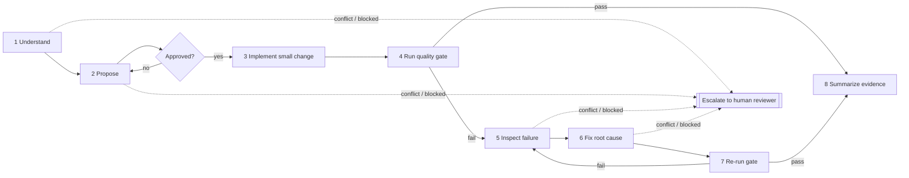

# AI development workflow

The repeatable loop every change goes through, whether made by an AI assistant or a human.
Project rules and commands live in [CLAUDE.md](../../CLAUDE.md); architecture rules in
[architecture.md](../architecture/architecture.md). This document defines the *process*.



## Hard rules
1. **Never bypass a failing test.** No `@Disabled`, no `-DskipTests`, no removing a test from the gate, no deleting or loosening assertions, no changing expected values to match wrong output.
2. **Never weaken the architecture to get green.** No editing, narrowing or disabling ArchUnit rules or `archunit.properties`, and no moving classes into packages just to escape a rule. Rules change only through an explicit human decision (plus an ADR if the decision is architectural).
3. **Escalate conflicts; don't resolve them silently.** See [Escalation](#escalation).

## Steps

| # | Step | Do | Done when |
|---|---|---|---|
| 1 | **Understand requirements** | Read the request, the relevant docs (CLAUDE.md, architecture.md, ADRs) and the existing code. Restate the goal in your own words. List assumptions and ambiguities. Check the request against existing rules and decisions. | The goal is restated, ambiguities are answered, and no unresolved conflict remains. |
| 2 | **Propose implementation** | Plan: approach, files to change, acceptance criteria, tests, new dependencies (with justification), and trade-offs with a recommendation. Use the `api-design` / `architecture-review` skills where relevant. Split work that is too big into increments. | The human reviewer explicitly approved the plan. |
| 3 | **Implement small change** | One approved increment only. Production code and its tests together. Stay inside the plan; anything extra goes back to step 2. | Code compiles locally and the new tests exist. |
| 4 | **Run quality gate** | `scripts/quality-gate.sh`. Keep the output. | Exit code 0 → step 8. Non-zero → step 5. |
| 5 | **Inspect failures** | Read the actual error for the failing stage (compile / unit / architecture / integration / preflight). Classify it with the table below. Find the root cause before changing anything. | The cause is identified and classified. |
| 6 | **Fix issues** | Apply the action allowed for that class. Fix the cause, not the symptom. | The fix is in place. |
| 7 | **Re-run verification** | Re-run the **whole** gate, not only the failing test. If the same stage still fails after **3 fix attempts**, stop and escalate. | The gate passes (→ step 8), or you have escalated. |
| 8 | **Summarize evidence** | Report using the template below. Don't commit unless asked. | The summary is delivered. |

## Failure triage (step 5 → 6)

| Class | Typical signal | Allowed action |
|---|---|---|
| Defect in new code | New or existing test fails because of the change | Fix the production code. |
| Defect in a new test | The test contradicts the approved acceptance criteria | Fix the test, and **state it in the summary** with the reason. |
| Existing test contradicts the new requirement | An older test encodes behaviour the request changes | **Escalate.** Changing established behaviour is a human decision. |
| Architecture violation | `architecture` stage fails | Restructure the code to comply. If compliance seems impossible or wrong, **escalate**. Never edit the rule. |
| Environment | Docker down, wrong JDK, network or dependency download | Fix the environment if it is within reach (start Docker, select JDK 21); otherwise report what the human must do. Don't change code to work around the environment. |
| Flaky / non-deterministic | Passes and fails without code changes | Find the cause (time, ordering, shared state) and make the test deterministic. Don't add retries or sleeps. |

## Escalation

Stop and ask the human reviewer when:
- requirements conflict with each other, or with CLAUDE.md, architecture.md or an ADR;
- the only way to pass is to change an existing test's expected behaviour, an ArchUnit rule, or an applied migration;
- the work needs scope beyond the approved plan, or a dependency the plan didn't include;
- acceptance criteria are ambiguous enough that two reasonable implementations would differ;
- the same failure survives 3 fix attempts, or the environment can't be fixed from the session.

Escalation format (then wait; don't continue on a guess):
1. **Context:** what was being done.
2. **Conflict:** the two things that can't both hold, quoting the sources.
3. **Options:** each with its consequences.
4. **Recommendation:** and why.
5. **Blocked:** what can't proceed until the human decides.

## Evidence summary template (step 8)

```markdown
**Change:** <one sentence>. Plan: <approved / deviations: …>
**Files:** <created / modified / deleted>
**Quality gate:** `scripts/quality-gate.sh` → exit <code>
| Stage | Result | Tests |
| compile | OK | – |
| unit | OK | <n> run, <f> failed |
| architecture | OK | <n> run, <f> failed |
| integration | OK | <n> run, <f> failed |
**Failures encountered:** <stage, cause, fix>, or "none"
**Tests changed (not added):** <test, reason>, or "none"
**Open decisions / escalations:** <…>, or "none"
**Not done:** <e.g. not committed, follow-ups>
```

Only report results from commands that were actually executed in this session. A test that was not run is reported as "not run", never as passed.
